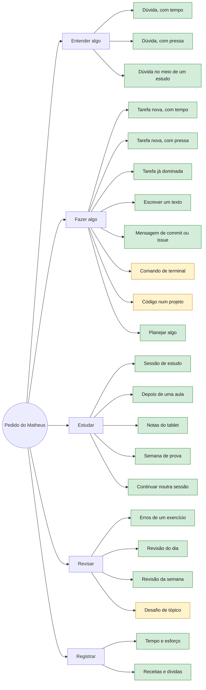

# Árvore de cenários de interação

**Rascunho para revisão (16/11).** Este documento lista os cenários em que o Matheus conversa com o Claude e mostra, para cada um, o que o cobre: um modo de interação das regras do método ou uma skill do plugin `tutor`. O objetivo é não criar skills repetidas ou sobrepostas e achar os cenários que ninguém cobre. As decisões tomadas aqui entram no [plano do método](plano-do-metodo.md) na próxima rodada de revisão e alimentam as regras definitivas (#3), as skills de tarefa (#1) e o plugin de estudo (#7).

## Como ler

Cada cenário é a combinação de duas perguntas:

1. **O que o Matheus quer?** Entender algo, fazer algo, estudar, revisar ou registrar.
2. **Com que perfil de resposta, e quanto ele já domina?** O perfil combina a pressa e o interesse do momento e só muda com um sinal do Matheus (seção *Perfil de resposta*, em estudo); sem sinal, vale o método completo. Tarefa já dominada (feita sozinho 3 vezes, a última há menos de 30 dias), o Claude faz e explica.

Cores na árvore: verde = coberto ou decidido; amarelo = proposta ou em estudo; vermelho = ninguém cobre (lacuna).

## Perfil de resposta (decidido em 16/11)

O Matheus sinaliza o perfil; o Claude nunca oferece o atalho por conta própria (16/11). O perfil combina duas variáveis do momento:

| | **Com tempo** | **Com pressa** |
|---|---|---|
| **Quero aprofundar** | Método completo (o padrão, sem sinal): perguntas-guia numa dúvida, *como fazer* numa tarefa, sessão de estudo | Resposta direta agora; uma dívida de aprendizado, no nível que o assunto pede, guarda o aprofundamento para depois |
| **Só quero saber** | Pergunta rápida enxuta: no máximo uma ou duas perguntas-guia, depois a resposta em poucas linhas; uma pergunta vai para a revisão | Resposta direta e curta; o registro segue o nível de dívida do assunto (abaixo) |

Formas de sinalizar (levantamento para estudo; podem ser combinadas):

| Forma | Como funciona | A favor | Contra |
|---|---|---|---|
| Palavra-chave no pedido | "rápido", "urgente", "aprofundar", "só quero saber" | Funciona em qualquer lugar, inclusive fora do Claude Code | Pode ser confundida com o uso comum da palavra ("explica rápido o que é..."); vale só para aquele pedido |
| Comando de barra por pedido | `/tutor:rapido <pergunta>` | Sem ambiguidade | Só onde o plugin chega |
| Perfil que dura | `/tutor:perfil pressa` vale até ser trocado ou até a sessão acabar; um gancho lembra o perfil a cada mensagem, e a linha de estado o mostra ("Perfil: pressa · só saber") | Um sinal vale para vários pedidos e fica sempre à vista | Mais peças para construir (gancho e estado); risco de esquecer o perfil ligado |
| Prefixo curto | Um símbolo combinado no começo do pedido (por exemplo, "»" para pressa) | Rápido de digitar | Fácil de esquecer o significado; outro ambiente não entende sem as regras |

**Adotadas (16/11):** palavra-chave, perfil que dura e comando por pedido; o prefixo curto ficou de fora.

### Comportamento padrão de cada skill por perfil (a construir)

Cada perfil tem um comportamento padrão em cada skill ou ferramenta. Assim o ambiente flui, sem perder a característica principal: a prioridade do aprendizado do Matheus. Cada skill vai trazer uma seção "Comportamento por perfil". A tabela abaixo é o ponto de partida, a validar skill por skill:

| Skill ou ferramenta | Com tempo + aprofundar (padrão) | Com tempo + só saber | Com pressa + aprofundar | Com pressa + só saber |
|---|---|---|---|---|
| Dúvida (pergunta rápida) | Perguntas-guia até o Matheus chegar à resposta | Uma ou duas perguntas-guia, depois a resposta curta | Resposta direta; dívida no nível do assunto | Resposta direta e curta; dívida no nível do assunto |
| Tarefa (*como fazer*) | Onde procurar; o Matheus monta; receita no fim | Pistas mais diretas (a fonte exata); o Matheus monta; receita curta | O Claude resolve, explicando cada passo; dívida | O Claude resolve, explicando cada passo; dívida no nível do assunto |
| Texto (`escrever-texto`) | Com ajuda: o Matheus escreve as versões | Ideias, com poucas rodadas | Gerado, com revisão dirigida; dívida para reescrever depois | Gerado, com revisão dirigida |
| Comandos de terminal | O Matheus monta; o Claude confere | O Matheus monta, com pistas mais diretas | O Claude monta e explica antes da aprovação | O Claude monta e explica antes da aprovação, de forma curta |
| Código (desenvolver) | As cinco situações do modo | As mesmas, com pistas mais diretas | O Claude escreve; *Nunca só aceitar* com revisão dirigida; dívida | O Claude escreve; revisão dirigida |
| Sessão de estudo (`roteiro`, `pista`, `fechar`) | Roteiro completo, pré-teste, escada e fechamento completo | Roteiro curto | A definir | A definir |
| Revisão (`revisar`, `revisao`) | As seis fases da revisão de erros; a fila do dia | A definir | A definir | A definir |

### Níveis de dívida (decidido em 16/11)

Uma dívida de aprendizado é o que fica para depois quando o Matheus usa um atalho. No lugar da dívida única do plano, o tamanho dela depende de quanto o assunto importa para o estudo dele.

| Nível | Quando | O que fica para depois |
|---|---|---|
| Alto | Conceito ou tarefa da área de estudo do Matheus (uma disciplina ou área do caderno), ou um assunto que já voltou outras vezes | Refazer sem ajuda; uma receita (tarefa) ou uma explicação escrita pelo Matheus (conceito); perguntas de revisão |
| Médio | Assunto ligado à área, mas periférico, ou fora da área e já repetido uma vez | Duas ou três perguntas de revisão; uma receita curta, se for tarefa |
| Baixo | Fora da área de estudo e pontual | Uma pergunta de checagem, para ver se o conteúdo fixou |

O Claude propõe o nível ao registrar, dizendo o porquê em uma frase, e o Matheus pode trocar. Um assunto de nível baixo que volta sobe de nível.

### Nunca só aceitar (decidido em 16/11)

Filosofia do Matheus (16/11): priorizar sempre o aprendizado e evitar ao máximo só aceitar um texto ou um código gerado pelo Claude ou por outra IA. Quando o Claude gera algo de peso (um texto, um trecho de código), o Matheus participa conforme o perfil:

- **Com tempo:** antes, o Matheus prevê o que o trecho deve fazer ou dizer; depois, responde uma pergunta de entendimento. É o princípio 3 do plano, "gerar e depois conferir o entendimento", o padrão de nota mais alta no estudo da Anthropic.
- **Com pressa:** revisão dirigida: o Claude aponta dois ou três pontos que o Matheus precisa conferir ou decidir (por exemplo, o argumento central de um texto ou o caso de borda de uma função) antes de usar o resultado.

### Desenvolver código (base, a refinar)

O "pôr a mão na massa" vale para estudo e trabalho, adaptado a cada cenário. No desenvolvimento:

| Situação | Quem faz o quê |
|---|---|
| Decisões de projeto (estrutura, dados, regras de negócio) | O Matheus decide; o Claude apresenta opções, com prós e contras |
| Código com algo que o Matheus não domina | O Matheus escreve, com pistas; o Claude explica e revisa |
| Código de rotina, já dominado | O Claude escreve; o Matheus confere pelo *Nunca só aceitar* |
| Depuração (achar a causa de um erro) | O Matheus levanta a hipótese primeiro; o Claude guia com perguntas e só depois mostra |
| Revisão de código | O Claude aponta os problemas como perguntas ("o que acontece se a lista vier vazia?") |

### Escrever textos (decidido em 16/11)

Uma skill só, `escrever-texto`, com uma escada de ajuda, para não haver várias skills disputando o mesmo gatilho na ativação automática:

| Grau | O que o Claude faz |
|---|---|
| Sozinho | Nada durante a escrita; no fim, revisa só se o Matheus pedir (até 5 pontos, sem frase pronta) |
| Ideias | Dá ideias (perguntas, uma estrutura possível, argumentos a considerar), sem escrever frases |
| Com ajuda | A regra *Textos*: o Matheus escreve as versões, e o Claude revisa por rodadas; é o padrão sem sinal |
| Gerado | O Claude escreve, e o Matheus confere pelo *Nunca só aceitar*; só com o sinal do Matheus |

- O tipo, o tamanho (curto: commit, issue, e-mail; longo: trabalho, relatório) e o formato (texto corrido e curto, dissertativo, estruturado em tópicos etc.), o Claude deduz sempre pelo contexto; as regras de cada tipo e de cada formato ficam em arquivos de apoio da skill.
- O grau, o Claude deduz só entre os que não são atalho; o "gerado" só entra com o sinal.
- A linha de estado mostra o que foi deduzido (por exemplo, "Texto: dissertativo · longo · com ajuda"), para o Matheus corrigir com uma palavra. Chamando `/tutor:escrever-texto topicos curto ideias`, as palavras depois do nome valem como parâmetros.
- As mensagens de commit e de issue são um tipo de texto curto dentro desta skill.

### Comandos de terminal (em estudo)

O Matheus quer montar os comandos para aprender e ter controle do sistema, inclusive os de leitura:

| Situação | O que acontece |
|---|---|
| Padrão, nas máquinas do Matheus | O Matheus monta os comandos, de leitura e de escrita, com pistas do Claude; o Claude confere e explica o risco antes de rodar |
| Domínio extremo (montado sozinho 5 vezes, sem erro) | O Claude roda, com uma explicação curta, focada no que pode não estar claro (uma opção menos usada, por exemplo); se passarem 15 dias desde o último uso, o comando volta para o Matheus montar e provar o domínio de novo |
| Com o sinal de pressa | O Claude monta e roda com mais liberdade, mas explica cada comando antes da aprovação, para o Matheus validar |
| Máquina que não é do Matheus | O Matheus monta tudo, de leitura e de escrita, e entende cada parte; o Claude só roda em casos raros, explicando cada parte |
| Implementação acelerada | Vale o modo revisor: o Claude roda, com o quadro completo, inclusive o que está dentro das aspas (filtros, padrões, variáveis) |

Todo comando rodado tem uma explicação do que está sendo feito, mesmo os dominados, para o Matheus sempre entender o que foi aplicado (16/11). Em aberto: quais são, além da pressa, os momentos em que o Claude pode ter mais liberdade. O quadro explicativo deixava de fora o que fica dentro das aspas; o estilo provisório foi corrigido em 16/11 (plugin 0.2.1).

### Perfil por dispositivo (para depois)

O Matheus pediu para explorar isso com calma, mais tarde (16/11). Ideia registrada: cada máquina declara o próprio tipo num arquivo local, que fica só nela e nunca vai para um repositório (o caderno é público, e o nome da máquina do trabalho não deve aparecer): por exemplo, "pessoal" ou "trabalho", com as regras de cada uma. No começo da sessão, o Claude lê essa declaração; máquina sem declaração recebe a regra mais rígida. Ideias do Matheus para as regras: no trabalho, nada que escreva em documentos; no celular, quando ele entrar no método, um ensino mais curto, porque ali o Matheus costuma estar com pressa. A declaração também ajuda a entender o uso dele em cada aparelho. O Claude não consegue ler a lista de dispositivos da conta do claude.ai.

## Cenários e quem os cobre

| Cenário | Exemplo | Quem cobre | Situação |
|---|---|---|---|
| Dúvida, com tempo | "O que é heterocedasticidade?" | Modo **pergunta rápida** (regras): perguntas-guia a partir do que o Matheus já sabe; no fim, o Claude confirma e completa, e uma pergunta vai para a revisão | Coberto |
| Dúvida, com pressa | "Rápido: qual a diferença entre erro tipo I e II?" | O *Perfil de resposta* com pressa: resposta direta, com a dívida no nível que o assunto pede; é o mesmo mecanismo do modo **urgente** | Decidido |
| Dúvida no meio de um estudo | Uma dúvida de fórmula durante um exercício | A dúvida fica na sessão em que nasceu (*Mapa de uso*); conceito já estudado vira revisão; fórmula pesada vai para um arquivo aberto na pré-visualização | Coberto |
| Tarefa nova, com tempo | "Conectar a rede com autenticação no Hyprland" | Modo **como fazer** (regras): onde procurar, o Matheus monta, o Claude confere, receita no fim | Coberto |
| Tarefa nova, com pressa | "Urgente: o Wi-Fi caiu antes da apresentação" | Modo **urgente** (regras): o Claude resolve, e a tarefa vira dívida | Coberto |
| Tarefa já dominada | Um comando de git feito sozinho 3 vezes no mês | O Claude faz e explica (regras) | Coberto |
| Escrever um texto | Um texto para um trabalho da faculdade | A skill `escrever-texto` (#1), com a escada de ajuda (seção *Escrever textos*) | Decidido |
| Mensagem de commit ou issue | O commit de uma mudança no código | Um tipo de texto curto dentro da skill `escrever-texto`; na implementação acelerada, o Claude escreve | Decidido |
| Comando de terminal | "Como listo os arquivos maiores que 1 GB?" | A escada de comandos (seção *Comandos de terminal*), com o quadro do estilo e o `/tutor:dissecar-comando` para entender um comando pronto, sem rodar | Em estudo |
| Código num projeto | Uma tela nova no SGMF | O modo *Desenvolver código* (seção acima) | Base, a refinar |
| Planejar algo | O plano de uma etapa | Modo de planejamento e regras de planos (núcleo provisório) | Coberto |
| Sessão de estudo | Estudar intervalos de confiança para a prova | Skills `roteiro` (completo ou curto), `pista` e `fechar` (#7) | Coberto |
| Depois de uma aula | Revisar a aula de hoje | Skill `aula` (incremento 10); candidato a analisar: Gemini, quando a aula estiver gravada em vídeo | Coberto (mais tarde) |
| Notas do tablet | As anotações da semana no Samsung Notes | Skill `notas` (incremento 8) | Coberto (mais tarde) |
| Semana de prova | Simulado de Inferência | Skill `simulado` (incremento 10) | Coberto (mais tarde) |
| Continuar noutra sessão | Retomar o estudo de ontem | Skill `retomar` | Coberto |
| Erros de um exercício | Corrigir uma lista | Skill `revisar` e o avaliador (#8) | Coberto |
| Revisão do dia | As perguntas que vencem hoje | Skill `revisao` (#8) | Coberto |
| Revisão da semana | Domingo à noite | Skill `semana` (#9) | Coberto |
| Desafio de tópico | O "chefe" ao fechar um tópico | Skill `desafio`, oferecida pelo `fechar` ao fechar um tópico e chamável depois, se adiado (16/11); falta decidir como identificar o desafio certo entre tópicos próximos (ideia inicial: cada desafio pendente fica no caderno com o caminho do tópico e a data; sem nome, a skill lista os pendentes) | Em estudo |
| Tempo e esforço | "Registra 50 min de Inferência, esforço 6" | Um passo do `fechar`, e o pedido solto tratado pelas regras, gravando no caderno (16/11) | Decidido |
| Receitas e dívidas | A receita de uma tarefa feita com o modo como fazer | Caderno de estudos (#4) | Coberto |

Fora da árvore, valem em todos os cenários: a linha de estado com o modo, o sinal de desinteresse (atalhos repetidos), o aviso de chat longo depois de uma pausa e as perguntas em vez de suposições.

## Textos fixos (para revisar com calma)

Linhas de estado, legendas e avisos que aparecem nas ferramentas do método. O Matheus quer revisar o formato e o texto de cada um, sem pressa (16/11):

| Elemento | Onde aparece | Exemplo |
|---|---|---|
| Linha de estado do modo | Regras (item 1.2 do plano) | "Modo: como fazer · passo 2 de 4" |
| Linha de estado do perfil | Perfil que dura (esta árvore) | "Perfil: pressa · só saber" |
| Linha de estado do texto | Skill `escrever-texto` (esta árvore) | "Texto: dissertativo · longo · com ajuda" |
| Quadro dos comandos | Estilo Aprendiz | Tabela "Parte / O que faz", com "Efeito" e "Saída esperada" |
| Marca de comando já visto | Estilo Aprendiz | "`git status` (já visto: mostra os arquivos alterados)" |
| Bloco Insight | Estilo Aprendiz | "★ Insight" com dois ou três pontos sobre o porquê de uma escolha |
| Glossário antes de um arquivo de código | Estilo Aprendiz | "Glossário de `registrar-comandos.mjs`" |
| Bloco "Aprender fazendo" | Estilo Aprendiz (suspenso na implementação acelerada) | "Contexto / Sua tarefa / O que pesar" |
| Pedido de aprovação de edição | Gancho do plugin | "Edição num plano ou nas regras do método: aprove ou rejeite antes de gravar." |
| Aviso de bloqueio de edição por script | Gancho do plugin | "Bloqueado: (motivo). Arquivos do repositório só são alterados com as ferramentas Edit e Write..." |
| Descrição de cada comando | Registro do terminal (`~/.claude/logs/terminal.log`) | "Mostra a situação do repositório" |
| Partes fixas do fim de uma tarefa | Núcleo provisório | "O que foi feito" / "O que precisa da validação do Matheus" |
| Avisos previstos no plano | Regras e plugin de estudo | Sinal de desinteresse; "Amanhã é o último dia para manter a sequência (30 minutos bastam)"; aviso de chat longo depois de uma pausa; resumo a cada mensagem |

## O que falta decidir

1. **Comandos de terminal:** quais são, além da pressa, os momentos em que o Claude pode ter mais liberdade.
2. **Desafio de tópico:** como identificar o desafio certo quando há vários pendentes em tópicos próximos.
3. **Perfil por dispositivo:** para depois, com calma (o formato da declaração local e as regras de cada tipo de máquina).
4. **Desenvolver código:** refinar as cinco situações, que ficaram como base.
5. **Sinais:** a lista exata de palavras-chave e os nomes dos comandos (nas tarefas das regras definitivas, #3, e do plugin de estudo, #7).
6. **Dúvida pontual:** confirmar que o perfil de resposta e o modo pergunta rápida a cobrem, sem skill própria.
7. **Comportamento padrão por perfil:** validar a tabela skill por skill, na tarefa de cada skill, e preencher o que está "a definir".
8. **Textos fixos:** revisar com calma o formato e o texto dos elementos da seção *Textos fixos*. Não é urgente; o estilo definitivo (#7) é o lugar natural para fixá-los.

## Já decidido nesta árvore (16/11)

- O Claude se adapta e nunca bloqueia: o padrão é o Matheus pôr a mão em tudo o que não domina, inclusive na parte mecânica e na estética; o atalho só existe com o sinal dele, e o sinal define um perfil de resposta, pela pressa e pelo interesse do momento.
- Sinais adotados: palavra-chave, perfil que dura e comando por pedido.
- A dúvida com pressa e a tarefa urgente são o mesmo mecanismo: o perfil com pressa.
- Dívida de aprendizado em três níveis (alto, médio e baixo), proposto pelo Claude com o porquê e ajustável pelo Matheus; o que volta sobe de nível.
- *Nunca só aceitar*, pelo perfil: previsão e pergunta de entendimento com tempo; revisão dirigida com pressa.
- Cada perfil terá um comportamento padrão em cada skill ou ferramenta.
- Textos: uma skill `escrever-texto`, com a escada de ajuda e com o tipo, o tamanho e o formato deduzidos pelo contexto; as mensagens de commit e de issue são tipos de texto curto dentro dela.
- Todo comando rodado tem explicação, mesmo os dominados: mais curta nos de rotina, focada no que pode não estar claro.
- Tempo e esforço: um passo do `fechar`, mais o pedido solto tratado pelas regras.
- Desafio de tópico: skill própria (`desafio`), oferecida pelo `fechar`.
- Desenvolver código: as cinco situações valem como base.
