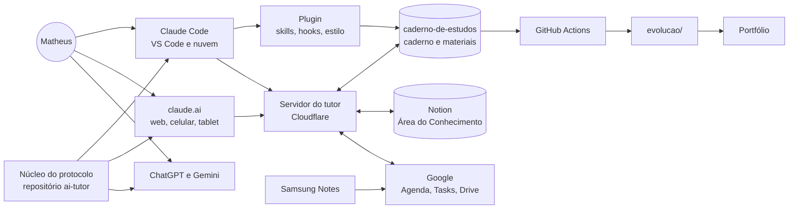

# Plano: método de aprendizado com IA (tutor)

**Em revisão.** Versão 16, de 16/11/2026. Desde essa data, este arquivo é a fonte do plano; antes, ele ficava só no computador do Matheus (`~/.claude/plans/`). O andamento fica na issue #2.

## O que mudou na versão 16 (16/11)

Primeira rodada da revisão (passo 4 da issue #2).

| Seção | Mudança |
|---|---|
| *Implementação acelerada* (nova) | Implementar de verdade, sem degraus provisórios; modo revisor (o Claude produz, o Matheus revisa) até o método estar implementado; sessão principal e tarefas com issue e sessão própria; brechas em issues; sete tarefas |
| Etapa prévia | Como revisar um plano que mora num repositório: uma cópia de trabalho no plano da sessão |
| Parte A | Objetivo no computador; regras redigidas pelo Claude e revisadas pelo Matheus (1.2); os outros ambientes esperam (1.3); caderno de estudos mínimo no lugar da caixa de entrada no Notion (1.4); 1.5 e 1.6 seguem a fase nova |
| *Quem escreve o quê* | A exceção do modo revisor |
| *Pontos em aberto* | Novo: PA-7 (terminal ou VS Code); na PA-5, a dúvida entre o repositório e o Notion como centro do conhecimento |
| *Pendências*; *Roteiro*; registros | O teste do plugin pela conta espera; as configurações do VS Code esperam a PA-7; incrementos 1 e 2 ajustados; decisões, rastreabilidade, conferência e histórico |

## O que mudou na versão 15 (16/11)

| Seção | Mudança |
|---|---|
| Local | O plano passa para este repositório, marcado "em revisão"; a parte do SGMF foi guardada no repositório dele |
| *Pendências reunidas* (nova) | O que ficou pendente nas conversas de 20/10 a 05/11, reunido no levantamento de 14/11, com a origem de cada item |
| *Pontos em aberto* | Novos: PA-3 (áudio), PA-4 (central de tarefas e eventos), PA-5 (Notion) e PA-6 (filtro de autorizações) |
| Etapa prévia | O `tutor@synced` chegou pela conta (14/11); o gancho de aprovação protege também este arquivo e as regras |
| Etapa 0 | A 0.1 fica coberta pelo núcleo provisório; a 0.2 foi feita em 16/11 |
| *Arquitetura* | Núcleo provisório e plugin `tutor` 0.2.0, com estilo e ganchos provisórios |
| *Ouvir em vez de ler* | A leitura por seções fica suspensa; o áudio vai para a PA-3 |

## O que mudou na versão 14 (03/11)

**A autorização de 03/11 vale só para a Etapa prévia.** As Partes A e B continuam em revisão.

| Seção | Mudança |
|---|---|
| Etapa prévia (nova) | Fluxo para aprovar cada edição do plano, reproduzível em outras máquinas pelo plugin `tutor` |
| Sequência de dias | Blocos de qualquer duração; 30 minutos é o total do dia |
| Trabalhar | Sessão livre; sinal de desinteresse no lugar da pausa |
| Etapa prévia | Resultados do teste de 03/11 e instalação pela conta do claude.ai (a testar) |
| Arquitetura; Fluxo; Medidas (04/11) | *Plugins e conectores em avaliação*; *Ouvir em vez de ler*; forma de contato |

# Etapa prévia: aprovar cada edição do plano

**Objetivo:** o Matheus vê cada edição e a aprova ou rejeita, como num arquivo comum, para garantir que os comentários dele entraram da forma certa.

**Quem faz:** o Matheus monta os comandos de criar e publicar o repositório e de instalar o plugin, com pistas do Claude; o Claude escreve os arquivos do plugin, e o Matheus aprova cada um pela comparação.

1. Criar o repositório público `ai-tutor` (o item 1.1 sobe para cá), como marketplace, com o plugin mínimo `tutor`, que por enquanto só tem o hook `pedir-aprovacao-do-plano.mjs` (curto, na forma de `bloquear-edicao-por-script.mjs`): edição em `~/.claude/plans/` responde "ask".
2. Instalar neste computador, com os comandos que servem para qualquer outro (ficam no README): `claude plugin marketplace add MatheusKubrusly/ai-tutor` e `claude plugin install tutor@ai-tutor`.
3. Registrar a regra na memória, até o núcleo existir.
4. Teste, de volta ao modo de planejamento, com uma edição de uma palavra (no computador, aprovado em 03/11):
   - o pedido de aprovação aparece;
   - a comparação abre, com aceitar e rejeitar;
   - rejeitada, a edição não é gravada;
   - aceita, a edição é gravada;
   - pelo Remote Control, no celular, o pedido de aprovação aparece; anotar se ele mostra a edição.
5. Se a comparação não abrir, no computador ou no Remote Control, cada edição passa a mostrar antigo e novo pelo formulário, e o Matheus decide se o hook fica.

**Regras depois do teste:**

- edições pequenas, nunca o arquivo inteiro;
- ao fim de cada rodada, uma tabela liga cada comentário à edição feita e ao resultado.

**Revisar um plano que mora num repositório (decidido em 16/11):** no modo de planejamento, o Claude só pode editar o plano da sessão, que o Claude Code cria com um nome gerado na hora em `~/.claude/plans/`. Por isso, cada rodada trabalha numa cópia:

1. **Abrir:** o Matheus entra no modo de planejamento; o Claude grava o conteúdo do plano no plano da sessão (com o pedido de aprovação) e confere com `diff` se as duas cópias ficaram idênticas.
2. **Revisar:** como antes, com edições pequenas na cópia, cada uma com a comparação; os comentários do Matheus vêm na recusa do plano.
3. **Fechar:** depois do "aprovado", o Claude sai do modo, confere pelo git se o plano do repositório mudou desde a cópia (se mudou, para e pergunta) e copia a versão aprovada por cima dele, de uma vez, com o `cp` (que pede aprovação e não depende de o Claude transcrever o texto). O `git diff` mostra todas as mudanças da rodada, e o Matheus confere antes do commit. Essa cópia inteira é a única exceção às edições pequenas, porque cada edição já foi aprovada na cópia.

**Onde o fluxo vale:**

| Onde | Como |
|---|---|
| Computadores (VS Code, terminal) | Plugin: hook e comparação |
| Celular, tablet ou navegador, pelo Remote Control | Sessão local: plugin e pedido de aprovação. Exige o computador ligado, sem suspender, e o `claude` rodando; ao acordar, reconecta sozinho (testado em 03/11) |
| Claude Code na nuvem (celular) | Sem plugin: regra do núcleo |
| claude.ai, ChatGPT, Gemini | Regra do núcleo |

Regra do núcleo: mostrar o antigo e o novo antes de gravar e esperar a resposta. Não há trava da ferramenta.

**Verificação em outra máquina:** na primeira vez em outro computador, os dois comandos bastam para o pedido de aprovação aparecer. Pendente: o Matheus não consegue testar agora, e a conferência fica para o primeiro uso real.

**Resultados do teste (03/11):**

| O que foi testado | Resultado |
|---|---|
| Aprovar e rejeitar pelo telefone, vendo o antigo e o novo | Passou, com a permissão manual, que pede aprovação mesmo sem o hook |
| Computador suspenso | A conexão cai; ao acordar, reconecta sozinha |
| Hook no modo de planejamento | Passou: o pedido apareceu, e a edição rejeitada não foi gravada |

**Instalar pela conta (decidido em 03/11, a testar):** em claude.ai, *Customize > Plugins > Add marketplace*, com `MatheusKubrusly/ai-tutor`. O plugin fica salvo na conta e chega sozinho aos outros computadores, sem os dois comandos.

| Onde | O que chega pela conta |
|---|---|
| Claude Code no terminal | O plugin inteiro, com os hooks |
| Claude Code no VS Code | A conferir: a documentação da sincronização só cita o terminal |
| Chat do claude.ai | Skills e comandos; hooks são ignorados |
| Claude Code na nuvem | Skills ligadas no claude.ai; a conferir se valem as de plugins |

Num computador com o `tutor@ai-tutor` instalado, a cópia instalada vale, e a da conta não carrega.

Em 14/11, o `tutor@synced` chegou pela conta, mas não carrega neste computador, porque a cópia instalada tem o mesmo nome e vale primeiro. Os testes da cópia da conta, no terminal e no VS Code, continuam pendentes (ver *Pendências reunidas*). Desde 16/11, o plano fica neste repositório, e o gancho de aprovação o protege, assim como as regras em `protocolo/`.

## O que mudou na versão 13 (02/11)

Validação dos três pontos que restavam. Ao prepará-los, a conferência de coerência achou dois problemas na versão 12.

| Seção | Mudança |
|---|---|
| Gamificação, sequência | **Corrigido:** o lembrete dizia "hoje é o último dia" no segundo dia sem estudo; agora é "amanhã é o último dia". **Corrigido:** o dia leve segurava a sequência para sempre; agora conta na tolerância de 2 dias. Os blocos do dia, de qualquer duração, se somam; o dia conta ao chegar a 30 minutos no total |
| Gamificação, esforço (novo) | **Esforço do dia**, de 1 a 9 (escala de Paas), como métrica qualitativa; um dia sem cronômetro conta como dia de estudo com esforço de 5 ou mais e uma linha sobre o que foi feito; tempo aproximado fica fora do ganho por hora |
| Medidas | Novas: esforço do dia; eficiência também como resultado × esforço |
| Gamificação, pontos | Confirmado: os valores são calibrados com dados, no incremento 9 |

## O que mudou na versão 12 (31/10)

Pedido do Matheus: nenhuma dúvida ou ponto em aberto que já possa ser decidido. Quatro rodadas de perguntas fecharam tudo o que era decisão; o que só se resolve testando virou uma lista de **verificações da execução**.

| Seção | Mudança |
|---|---|
| **Gamificação** (nova; PA-2 decidido) | Só o domínio confirmado gera pontos; jogo da calibração com a confiança em porcentagem (alta = 80% ou mais); mapa que acende, nível por área, conquistas, portfólio; desafio de tópico ("chefe"), adiável e exigido para o nível 4; **sequência de dias de estudo** (substitui o "sem sequências" de 28/10), com lembrete no segundo dia sem estudo |
| Fluxo | Confiança em porcentagem; uma pergunta de revisão escrita pelo Matheus por sessão |
| Integrações | Repositórios `ai-tutor` e `caderno-de-estudos`; gabaritos públicos, quando houver; exportação do Samsung Notes uma vez por semana; app do Google publicado, sem verificação; o Drive é lido nas sessões, e não pelo servidor |
| Arquitetura | Servidor: conector e agendamentos; GitHub Actions: só arquivos (V20); sincronização no começo de cada sessão e uma vez por noite; revisão da semana pronta no domingo à noite |
| Roteiro de incrementos | Ordem confirmada |
| Pontos em aberto | Nenhuma decisão pendente; seção nova *Verificações da execução* |

## Contexto

O Matheus quer usar a IA como **tutor** em **todas as interações**: estudos (ex.: Inferência Estatística), tarefas práticas do dia a dia (ex.: configurar uma rede com autenticação no Hyprland), projetos e o que vier; em qualquer ferramenta (Claude Code no VS Code e no celular, claude.ai na web, no celular e no tablet, ChatGPT, Gemini) e em qualquer computador. **O objetivo é usar a IA de forma inteligente: aprender mais coisas, em menos tempo, do que estudando sem ela.**

O hábito que ele quer perder: copiar e colar o que a IA gera, por preguiça, sem aprender a reproduzir. Ele usa IA todos os dias e, até o método existir, continua usando do jeito que não quer mais. Por isso, **quanto antes o método começar, melhor**.

Decisões que moldam o plano:

- **Tudo, sem exceção** (20/10): o método vale para estudos, documentos, código, comandos e rotinas.
- **Implementar e refinar aos poucos** (29/10): o plano dá a noção do todo, mas cada incremento é planejado em detalhe na hora de começar, e o método já é usado desde o primeiro (na *Implementação acelerada*, de 16/11, o uso espera a implementação de verdade).
- **Foco 100% no fluxo geral** (28/10): o SGMF fica em pausa e guardado no próprio repositório (etapa 0.2, feita em 16/11: `planos/fluxo-de-trabalho.md`).
- **Tudo pode ser público** (28/10).
- **O conhecimento é para a vida toda** (28/10).

# Implementação acelerada (decidida em 16/11)

**Por quê:** o Matheus quer acelerar ao máximo a implementação de verdade do método. Em vez de degraus provisórios (como a caixa de entrada no Notion, que depois migraria para o caderno), cada tarefa constrói o que será usado no dia a dia, mesmo que o método fique mais tempo sem funcionar. Assim, "quanto antes o método começar, melhor" passa a valer para o método de verdade, e o uso desde o primeiro incremento (29/10) espera o fim desta fase.

**Modo revisor:** nesta fase, o Claude produz, e o Matheus revisa e aprova. O Claude escreve os textos de rotina (issues, comentários, mensagens de commit, edições do plano), as regras definitivas, as skills, o estilo e todo o código, sem deixar trechos para o Matheus completar; monta e roda os comandos, com o quadro explicativo. O que publica algo fora do computador (push, criar issue, renomear repositório) espera o "pode" do Matheus. O modo vale até o Matheus declarar o método implementado e fica registrado no núcleo provisório, para toda sessão segui-lo.

**Sessões:**

- **sessão principal** (a sessão "ai-tutor · revisão do plano"): alinha os pontos em aberto e o restante da revisão, transforma em tarefa o que ficar pronto para implementar e confere a coerência entre as tarefas;
- **sessões de tarefa:** cada tarefa tem uma issue, num Project do GitHub, e uma sessão com nome; no máximo 2 ou 3 ficam abertas ao mesmo tempo, e o Matheus escolhe quais abrir depois de as issues existirem;
- **brechas:** a sessão que perceber uma brecha no método abre uma issue com a etiqueta "brecha" (o que aconteceu, onde e quais tarefas pode afetar), sem depender das outras; toda sessão lista as brechas abertas ao começar e antes de fechar a sua tarefa, e a sessão principal analisa cada uma;
- **adaptação:** se uma tarefa se sobrepuser a outra, depender de outra ou mudar algo que afete outra issue ou uma tarefa em andamento, as issues afetadas são ajustadas na hora, com um comentário que diz o que mudou e por quê, para o fluxo continuar coerente com várias sessões abertas.

**Tarefas desta fase** (a ordem segue o *Roteiro de incrementos*):

| Tarefa | O que entrega | Depende de |
|---|---|---|
| Regras definitivas | O núcleo do protocolo (item 1.2), no lugar do núcleo provisório | — |
| Caderno de estudos mínimo | O repositório `caderno-de-estudos`, com perfil, conceitos, respostas, receitas, fila e desempenho (item 1.4) | — |
| Avaliar plugins e conectores | A decisão, candidato por candidato, e a instalação dos aprovados (*Plugins e conectores em avaliação*) | — |
| Estudar o áudio | Como usar a leitura em voz alta e o ditado no método (PA-3) | — |
| Plugin de estudo | Estilo definitivo; skills de roteiro, pistas e fechamento; gancho de início de sessão (incremento 2) | Regras definitivas; caderno |
| Revisão de erros e espaçada | Skill de revisão de erros, avaliador e revisão espaçada (incremento 3) | Plugin de estudo |
| Medidas e acompanhamento | Medidas, retrato, níveis, revisão da semana, sequência de dias e calibração (incremento 5, sem os dados do chat comum) | Plugin de estudo |

As skills de tarefa já têm issue própria (#1); as quatro perguntas dela são alinhadas na sessão principal antes da implementação.

**Esperam:** o celular, o claude.ai, a nuvem, o ChatGPT e o Gemini, até haver uma versão mais palpável do método; o teste do plugin que chega pela conta, porque desligaria a cópia instalada de que as sessões abertas dependem; as configurações do VS Code, até a PA-7.

# Parte A: Incremento 1, o núcleo em todo lugar

**Objetivo:** o núcleo de verdade e o caderno de estudos, primeiro no computador, como base do plugin de estudo (ver *Implementação acelerada*). O celular, o claude.ai, a nuvem, o ChatGPT e o Gemini esperam uma versão mais palpável do método.

### Etapa 0: guardar o SGMF e registrar a memória

- **0.1 Memória do Claude:** uma memória com a regra da transição entre planejar e executar e a preferência do Matheus por ser interrogado (perguntas com contexto e cenários; uma de cada vez quando ele pedir; nenhuma proposta entra no plano sem passar por ele). Vale até o núcleo existir. Desde 16/11, essas regras estão no núcleo provisório (`protocolo/nucleo-provisorio.md`), que todas as sessões locais leem.
- **0.2 SGMF:** a antiga Parte 2 (*Anexo*) vira um arquivo no repositório do SGMF, fora de `docs/`, em `planos/fluxo-de-trabalho.md`. O trabalho não commitado (gancho de bloqueio, `.githooks/pre-commit`, mudança no `.claude/settings.json`) entra num commit próprio. Os dois commits levam `Refs #15`; um comentário na #15 explica a pausa e aponta para o arquivo; o cartão volta para "Ready". O Matheus escreve as mensagens. Feita em 16/11 (commits 309fc80, 18ec163 e 8d3e6b4 no SGMF; cartão da #15 em "Ready"); as mensagens foram escritas pelo Claude, com autorização do Matheus.

### Etapa 1: o núcleo

- **1.1 O repositório `ai-tutor`** vem da Etapa prévia; aqui recebe o núcleo, o mapa e as issues dos incrementos.
- **1.2 Escrever o núcleo do protocolo** (`protocolo/nucleo.md`, umas 30 linhas), pelo modo revisor (*Implementação acelerada*): o Claude redige a partir das decisões do plano, e o Matheus revisa. Antes de 16/11, o Matheus escreveria, pela escada dos textos. Ao fim, o Claude confere se o texto cobre o conteúdo previsto (lista abaixo, para conferência, e não para cópia):
  - os **modos de interação** e como o Claude reconhece cada um;
  - a **escada** e quem sobe os degraus;
  - **perguntas em vez de suposições** (formulário onde existe; perguntas numeradas, com opções em letras, onde não existe);
  - **professor questionador**, exigente mas curto;
  - **fase de estudo × fase prática** (explicação em camadas só na fase de estudo);
  - **parte conceitual × parte mecânica**, com o "ensinar a buscar";
  - o **registro** no caderno de estudos;
  - a **linha de estado** com o modo (ex.: "Modo: como fazer · passo 2 de 4");
  - a **transição entre planejar e executar**;
  - a **revisão de planos**: cada edição mostra o antigo e o novo e espera a aprovação do Matheus;
  - em conflito com instruções de um projeto (ex.: o estilo Aprendiz do SGMF, em pausa), o Claude pergunta qual vale.
- **1.3 Levar o núcleo a todo lugar** (parte mecânica, com o Matheus fazendo o que ainda não domina). Por ora, só o Claude Code local, que já lê o núcleo provisório; os outros ambientes, e as verificações da execução ligadas a eles, esperam uma versão mais palpável do método (decidido em 16/11):
  - **Claude Code local, todos os projetos:** o `~/.claude/CLAUDE.md` importa o arquivo com a sintaxe `@` (fonte única);
  - **Claude Code na nuvem** (como no celular): um script de preparação do ambiente baixa o mesmo arquivo do repositório público para `~/.claude/CLAUDE.md` (a conferir na execução);
  - **claude.ai** (web, celular, tablet): a **versão curta**, escrita pelo Matheus a partir do núcleo (modo A) e conferida pelo Claude, vai para as Preferências;
  - **ChatGPT e Gemini:** a mesma versão curta (*Instruções personalizadas*; um *Gem*).
- **1.4 Caderno de estudos mínimo** (16/11, no lugar da caixa de entrada no Notion, que só se justificava pelo acesso do celular): o repositório `Disciplinas-da-Faculdade` vira o `caderno-de-estudos`, com o caderno mínimo (perfil, conceitos, respostas, receitas, fila e desempenho). Ele guarda desde já as **receitas** (escritas pelo Matheus), as **respostas**, as **perguntas para revisar** e as **dívidas**. Até o conector existir, só o Claude Code no computador o alcança.
- **1.5 Mapa e tarefas:** o plano já está neste repositório desde 16/11 (`docs/plano-do-metodo.md`, em revisão). Nesta fase, o trabalho segue em sessão principal e tarefas com issue e sessão própria (ver *Implementação acelerada*). Com o plano todo aprovado, este arquivo fica com o mapa (Parte B), e cada incremento vira uma issue com checklist, num Project do GitHub, como no SGMF.
- **1.6 Uso no dia a dia** (16/11, no lugar da semana de uso com retrospectiva): depois da implementação, o teste é o uso de rotina; cada brecha percebida vira uma issue "brecha", e a sessão principal escolhe as próximas tarefas e ajusta o núcleo.

### Verificação do incremento 1

- Numa sessão nova do Claude Code, em qualquer projeto, uma **pergunta rápida** recebe perguntas-guia, e não a resposta; um **"como fazer"** começa por "onde você procuraria?", e o Claude confere os comandos antes de rodá-los; um pedido **"urgente"** é resolvido e vira dívida no caderno.
- Quando os outros ambientes entrarem (1.3): o mesmo comportamento no claude.ai (web e celular), num teste com uma pergunta rápida; o núcleo carregado numa sessão do Claude Code na nuvem; um exercício de teste no ChatGPT e no Gemini seguindo os modos.
- A linha de estado mostra o modo.
- O caderno recebe os registros das sessões no computador.
- O mapa está no `ai-tutor`, e as issues dos incrementos existem.

# Parte B: o mapa do método

Tudo abaixo é a noção do todo. Cada parte entra no incremento indicado no *Roteiro de incrementos* e é detalhada na hora de começar.

## Modos de interação (decisões de 29/10)

O Claude reconhece o modo no começo de cada conversa, mostra-o na linha de estado, e o Matheus pode trocar.

- **Pergunta rápida** (ex.: "o que é heterocedasticidade?", para revisar ou conhecer um conceito): sem roteiro e sem resposta de cara. Perguntas-guia curtas, partindo do que o Matheus já sabe ou intui, até ele chegar à resposta; se travar, a escada. No fim, o Claude confirma e completa em poucas linhas, e uma pergunta vai para a revisão. Se o Matheus quiser aprofundar, a explicação em camadas fica para a fase de estudo.
- **Como fazer** (ex.: "conectar a rede com autenticação no Hyprland"): sem a solução pronta. O objetivo é **aprender a buscar**, para reproduzir depois sem depender da IA, mesmo com menos profundidade:
  1. objetivo e contexto (o que se quer, o que já foi tentado, o sistema);
  2. "onde você procuraria?" — se o Matheus não souber, o Claude indica o **tipo de fonte** (documentação oficial, wiki da distribuição ou da ferramenta, `man`, `--help`, `tldr`) e os **termos de busca**, e não a resposta;
  3. o Matheus lê e monta os passos ou comandos; o Claude pergunta o que cada parte faz;
  4. antes de rodar algo que altera o sistema, o Claude confere e explica os riscos;
  5. o Matheus escreve a **receita** com as próprias palavras (passos, onde encontrou, armadilhas), e uma pergunta vai para a revisão.

  Critério de pronto: o Matheus conseguiria refazer sem IA, com a receita e a fonte. Uma tarefa já dominada (feita sozinho 3 vezes, a última há menos de 30 dias) o Claude pode fazer e explicar.
- **Estudo ou tarefa grande:** `/tutor:roteiro` (completo ou curto) e o fluxo de uma sessão de estudo (abaixo).
- **Urgente** (o Matheus diz "urgente"): o Claude resolve, com explicação curta, e a tarefa vira **dívida de aprendizado**, com a receita a escrever e uma pergunta para depois.

## Mapa de uso (guia, não regra)

| Situação | Onde costuma ser melhor |
|---|---|
| Estudo com código (ex.: Inferência) e desenvolvimento | Claude Code no VS Code (o método mais completo) |
| Dúvida de fórmula no meio da sessão | Na mesma sessão; com fórmula pesada, o Claude a escreve num arquivo temporário, aberto na pré-visualização de Markdown do VS Code (o painel do Claude desenha fórmulas de forma instável) |
| Pergunta complexa fora de uma sessão de código | claude.ai, no Projeto da disciplina |
| Dúvida rápida, tarefa simples | Onde o Matheus estiver: computador (o mais comum), celular ou tablet |
| Revisões espaçadas | Celular ou tablet |
| Continuar em outra máquina | Remote Control, com o computador ligado; Claude Code na web; ou uma sessão nova com `/tutor:retomar` |

A vida real não segue o mapa à risca (Claude Code no celular, dúvidas rápidas no computador). Por isso, o núcleo vale em todos os lugares, e a regra é só esta: **a dúvida fica na conversa em que nasceu**, para entrar nos conceitos tocados e no fechamento; até o conector existir, o que for resolvido fora é registrado no caderno numa sessão do computador.

## Princípios de desenho

| Princípio | De onde vem | Onde aparece no fluxo |
|---|---|---|
| 1. **Testar-se e espaçar** são o motor | Dunlosky et al.: as duas únicas técnicas com nota alta entre dez | Pré e pós-teste, fechamento, revisão espaçada |
| 2. **Tentar antes da ajuda** | Pré-teste; fracasso produtivo; MIT | Modos pergunta rápida e como fazer, pré-teste, degrau 1 da escada |
| 3. **Gerar e depois conferir o entendimento** | Anthropic: o padrão de nota mais alta (86%) | Modo C com previsão e pergunta de entendimento |
| 4. **A ajuda diminui com o domínio** | Reversão da expertise; aprendizagem para o domínio (Bloom) | Modo escolhido pelo nível do conceito; ajuste automático da ajuda; tarefas dominadas |
| 5. **Estrutura fora do prompt** | Harvard: o prompt sozinho não guiava problemas com várias partes | Roteiro, estado da sessão, hooks, conector e painel |
| 6. **A IA erra e infla a confiança** | Harvard; Aalto | Gabarito oculto, conferência por código, confiança antes da nota, armadilhas com fonte |
| 7. **Medir para saber** | Objetivo do Matheus: superar o estudo manual | Medidas, retrato, revisão da semana, gráficos |
| 8. **Camadas de reforço** | Limites das ferramentas | Núcleo em todo lugar; skills; conector; hooks; painel |
| 9. **Aprender em público** | swyx, "Learn in Public" | Repositórios públicos; portfólio com a curva de aprendizado |
| 10. **Aprender a buscar** | Pedido do Matheus (29/10): reproduzir sem depender da IA | Modo como fazer; receitas |

Os cinco princípios do LearnLM (Google) servem de conferência: aprendizado ativo, carga cognitiva, adaptar ao aprendiz, curiosidade e metacognição. Os 4 Ds do *AI Fluency* também: delegar (conceitual × mecânica), descrever (objetivo, roteiro, análise dos prompts), discernir (professor questionador, conferência) e diligência (integridade acadêmica).

## O fluxo de uma sessão de estudo

Cinco momentos: **abrir → trabalhar → revisar erros → fechar → revisar depois**.

### 1. Abrir: o roteiro

- **Quando:** no começo de cada tarefa de estudo. Se o Matheus esquecer, o Claude sugere: "Reenvie a mensagem com `/tutor:roteiro`". Quem chama a skill é sempre o Matheus.
- **Completo ou curto:** `/tutor:roteiro` ou `/tutor:roteiro curto`; sem indicação, o Claude pergunta. No curto: roteiro de uma linha com o modo, sem pré-teste, e uma pergunta no fechamento só se aparecer algo novo.
- **Duas perguntas antes:** o objetivo e o tempo e o prazo; o Claude confirma o que o material e a agenda já dizem e pergunta só o que falta. O que o Matheus já sabe fica a cargo do pré-teste e do retrato.
- **Pré-teste:** 2 ou 3 perguntas, sem consulta, com a confiança em porcentagem (ex.: 70%); de intuição em assunto totalmente novo.
- **O roteiro é só o plano de abordagem** e nunca traz respostas.
- **Modos de cada parte:** A (sozinho), B (com a escada), C (em etapas, com previsão antes e pergunta de entendimento depois). O modo segue o nível do conceito: níveis 0 e 1 → C ou B; nível 2 → B; níveis 3 e 4 → A. O Matheus pode trocar.

### 2. Trabalhar

- **Fase de estudo × fase prática:** na fase de estudo, explicações aprofundadas, em camadas: ideia central → por quê → quando vale → pergunta antes das armadilhas → armadilhas e detalhes esquecidos (da lista da área, com fonte) → exemplo e contraexemplo → ligação com o que o Matheus já sabe → fonte e pergunta de checagem. Na fase prática e na caça aos erros, a escada.
- **Escada:** perguntas → pistas → pontos que faltaram ou exemplo parecido → resposta comentada, refeita sem olhar. Quem sobe é o Matheus.
- **Ajuste automático da ajuda**, com aviso (em observação).
- **Explicação do jeito que funciona**, segundo o perfil.
- **Avançar de parte:** o Claude sugere; o Matheus decide.
- **Textos:** o Matheus escreve todas as versões; o Claude revisa sem dar a frase pronta (até cerca de 5 pontos por rodada); critério de pronto em 4 pontos.
- **Parte conceitual × mecânica:** a conceitual é do Matheus; a mecânica não dominada, ele aprende a buscar e faz; a dominada, o Claude faz e explica; a estética, o Claude faz e diz o que mudou; o que vale automatizar, o Claude aponta. Revisores automáticos conferem a parte mecânica.
- **Precisão do tutor:** gabarito (quando houver, em `gabaritos/`, público; o avaliador o lê, e o Matheus não o abre antes de tentar), conferência por código, incerteza dita às claras.
- **Conceitos novos** (1 ou 2 por tarefa), **dicas do manual**, **sessão livre, sem aviso de tempo nem de cansaço**; **sinal de desinteresse:** diante de uma sequência prolongada de pedidos de resposta pronta, sem tentativa nem perguntas sobre o porquê, o Claude sinaliza uma vez, citando o que viu, para o Matheus perceber que não está aprendendo e decidir se volta ao método (não bloqueia; urgentes repetidos contam; tarefas dominadas e parte estética, não), **padrões na forma de pensar** (perguntados na hora), **comandos de terminal** (o quadro vem depois quando o Matheus monta; antes quando o Claude roda).

### 3. Revisar erros: ciclo em 6 fases

1. Autoconferência (a primeira pergunta mira o padrão de erro do perfil) e confiança.
2. Localizar. 3. Classificar (erros mecânicos à parte). 4. Revelar (o Matheus propõe a correção). 5. Entender a causa (erro típico; os de confiança alta, 80% ou mais, vão primeiro para a fila). 6. Conferir (o `avaliador`, com o gabarito).

### 4. Fechar

Lembrança livre (com as etiquetas da disciplina); pós-teste; todo conceito ganha ao menos uma pergunta; tipos variados de exercício (inclusive ensinar ao Claude e achar o erro); critérios de Matuschak; uma pergunta própria escrita pelo Matheus sobre o que achou mais importante, revisada pelo Claude pelos mesmos critérios; confiança, nota e perguntas do professor questionador; reflexão sobre o processo; próximo passo de estudo; registro.

### 5. Revisar depois

No fluxo de trabalho ou no celular; intercalada; no máximo 20 por dia, com prioridade (erros de confiança alta → pré-requisitos fracos do que vem a seguir → mais atrasadas); intervalos 1 → 3 → 7 → 21 → 60 dias; dias com revisão no Google Tasks.

### Ouvir em vez de ler (decisão de 04/11)

**Em revisão (16/11):** o Matheus não gostou da `leitura-inteligente` como está e quer repensar com calma o uso de áudio no método, para ouvir e para falar (PA-3). O que está nesta seção vale como material.

Ouvir é uma forma de acesso ao material, e não um estilo de aprendizagem. Ler e ouvir praticamente empatam na compreensão, com pequena vantagem para ler no próprio ritmo (Clinton-Lisell, 2021). Por isso, pausar, voltar e pular de seção são obrigatórios. O ganho é poder estudar quando não dá para ler; em tempo, ouvir costuma ser mais lento.

| Momento | Como |
|---|---|
| Fase de estudo, primeiro contato | Depois do pré-teste, ouvir uma seção; ao fim dela, uma pergunta de lembrança, sem consulta |
| Leitura fora do método (texto corrido) | Readwise Reader, a testar; o que for aprendido vai para o caderno, e a revisão diária dele não é usada |
| Revisar documentos (planos, SGMF); material com tabelas, códigos e fórmulas | `leitura-inteligente`, que reescreve para o ouvido, sem omitir pontos; depende do computador ligado |

A leitura por seções, decidida em 04/11, ficou suspensa em 16/11: as 9 edições preparadas para a `leitura-inteligente` não foram gravadas e viram material da PA-3.

### Situações especiais

Pergunta de estudo no chat comum (conceito já estudado vira revisão); depois de uma aula (`/tutor:aula`); leitura do livro fora do método; anotações do Samsung Notes (`/tutor:notas`); conceitos de antes do método (entram quando reaparecem); prazo curto (dívida de aprendizado); semana de prova (`/tutor:simulado`, com diagnóstico); trabalho em grupo.

### Regras de toda interação

- **Perguntas em vez de suposições**, em todos os ambientes.
- **Professor questionador**, exigente mas curto.
- **Discordância decidida por uma fonte**, com a taxa de erro do tutor.
- **Transição entre planejar e executar.**
- **Chat longo depois de uma pausa:** aviso de custo e sugestão de chat novo.
- **Integridade acadêmica.**
- **Onde o Claude grava:** no Notion, só nas bases do tutor; páginas pessoais fora delas nunca são abertas.

## Perfil e acompanhamento personalizado (decisões de 28/10)

- **Guardado em:** `caderno/perfil.md` (escrito pelo Matheus, a partir de um questionário de cerca de 8 perguntas; sem "estilos de aprendizagem"), `caderno/retrato.md` (gerado, nunca editado à mão) e `caderno/desempenho.csv` (fonte única dos números). Todo ambiente lê o perfil pelo conector; as memórias automáticas não guardam cópias.
- **Conceito:** uma ideia que cabe numa boa pergunta de revisão, organizada por assunto (área › tópico › conceito), com a disciplina como etiqueta; cada conceito existe uma vez só.
- **Níveis:** 0 não visto; 1 apresentado; 2 em prática; 3 dominado (nota ≥ 3 sem ajuda, 2 vezes, com ≥ 7 dias entre elas); 4 consolidado (+ acerto depois de ≥ 21 dias + página escrita + desafio do tópico vencido). Erro sem ajuda → nível 2.
- **Mapa de pré-requisitos** montado pelo Matheus ao fechar um tópico.
- **O perfil muda:** o modo de cada parte, a autoconferência, a explicação, a prioridade da revisão e o próximo passo.
- **O que funciona** se descobre por reflexão + números, e só vira regra se o Matheus decidir.
- **Coleta automática** (só números): tempo por parte e degrau, produção própria, padrão de interação, uso do método; no chat comum, o conector registra o mínimo (duração aproximada, pistas, padrão, palavras escritas), e a revisão da semana separa a origem dos dados. Análise semanal dos prompts, com sugestões.
- **Revisão da semana** (`/tutor:semana`): tempo, esforço, sequência de dias, aprendizado, eficiência, calibração (escore de Brier), como o Matheus instruiu a IA, pendências e a parte escrita por ele (o que funcionou, o que travou, o que muda, eventos atípicos, autoavaliação). Os números da semana (de segunda a domingo) ficam prontos no domingo à noite; a revisão aparece nas pendências e no Tasks a partir de segunda, sem horário marcado, até o Matheus fazê-la.

## Medidas

Rubrica de qualidade de 0 a 4 (a ajuda fica na coluna do degrau). Medidas: ganho da tarefa, calibração, retenção, autonomia, eficiência (ganho e retenção por hora, só com tempo cronometrado; e resultado × esforço: nota alta com pouco esforço mostra domínio, nota baixa com muito esforço mostra onde rever), esforço do dia (de 1 a 9), produção própria, padrão de interação, uso do método, taxa de erro do tutor e forma de contato (áudio ou leitura, para comparar a retenção de cada uma; só vira regra se o Matheus decidir). Até o Registro de estudo existir (incremento 6), o tempo e o esforço são informados no fechamento ou ao dizer "registra 50 min de Inferência, esforço 6", e vão para o caderno. Gráficos no repositório (`evolucao/`, com a curva de aprendizado), no Notion e no portfólio.

## Gamificação (decisões de 31/10)

- **Só o domínio confirmado gera pontos:** um conceito que chega a dominado ou consolidado; a retenção confirmada depois de 21 e de 60 dias; um erro achado na fase 1 da revisão; uma receita usada para refazer algo sem IA; um desafio de tópico vencido. Nada por tempo, por quantidade de perguntas ou por presença. Sem metas.
- **Jogo da calibração:** a confiança é dada em porcentagem (ex.: 70%) em todo o método. A revisão da semana mostra o escore de Brier (quanto menor, melhor; 0,25 é o chute de 50%) e o gráfico de calibração ("quando digo 70%, acerto 70% das vezes?"); o portfólio mostra a evolução. **Confiança alta** = 80% ou mais.
- **Progresso visível:** o mapa de conceitos acende por nível, como uma árvore de habilidades; cada área tem um nível, que sobe com os pontos de domínio; conquistas de domínio (marcos raros, nada por frequência); tudo também no portfólio.
- **Desafio de tópico ("chefe"):** ao fechar um tópico, o Claude pergunta "Está com tempo para o desafio do tópico (uns 30 minutos)?". O desafio mistura os conceitos do tópico, sem consulta e com tempo (teste de transferência). Sem tempo, ele fica pendente (nas pendências e no Tasks). Vencê-lo (nota 3 ou mais) é exigência para os conceitos do tópico chegarem ao nível 4 e dá uma conquista.
- **Sequência de dias de estudo** (substitui o "sem sequências" de 28/10; o "sem metas" continua):
  - **dia de estudo:** ao menos 30 minutos cronometrados no total do dia, **somando os blocos, de qualquer duração**. O tempo registrado pelo Matheus é tempo produtivo: ele mesmo separa o que não foi. **Sem cronômetro** (nem toda tarefa tem o tempo medido), o dia conta se ele declarar esforço de 5 ou mais (de 1 a 9) e disser em uma linha o que fez; um tempo aproximado, quando houver, entra na soma da semana, mas fica fora do ganho por hora;
  - **dia leve** (só dúvidas rápidas, coisas simples): fica registrado e aparece na revisão da semana, pesando menos, mas não aumenta a sequência nem a segura sozinho: conta na tolerância;
  - **até 2 dias seguidos sem estudo** não quebram; o terceiro quebra, tenha ele dúvidas rápidas ou não. Sem folga planejada: o Matheus estuda quando tem vontade e disposição;
  - o **aprendizado do dia** (ganho, revisões certas, conceitos que subiram) e o **esforço do dia** aparecem ao lado do tempo na revisão da semana, para avaliar a produtividade além das horas;
  - **lembrete no segundo dia sem estudo:** "Amanhã é o último dia para manter a sequência (30 minutos bastam)", sem horário, no Tasks; até o incremento 7, o aviso aparece só no começo das sessões.
- **Esforço do dia** (a métrica qualitativa): uma pergunta, "quanto esforço mental o dia exigiu?", de 1 a 9 (escala de Paas), mais uma linha opcional sobre o que foi feito. Vem junto do registro do bloco ou do fechamento; num dia sem registro, a primeira conversa do dia seguinte pergunta sobre ontem, e a pergunta pode ser pulada.
- **Calibrados com dados, no incremento 9:** os valores de cada tipo de ponto e os limites dos níveis por área. Decidir isso antes das primeiras semanas de uso seria chute. O Claude propõe a partir dos dados, e o Matheus decide; os eventos ficam na planilha desde o incremento 5, então os pontos podem ser calculados para trás.

## Integrações (decisões de 28/10)

- **Repositórios públicos** (nomes de 31/10): `ai-tutor` (a ferramenta: o plugin `tutor`, o servidor, o VS Code, o `instalar.sh`, o manual e o mapa) e `caderno-de-estudos` (o `Disciplinas-da-Faculdade` renomeado: caderno, materiais, evolução e, quando houver, gabaritos). Os gabaritos são públicos, sem preocupação de privacidade; o avaliador os lê, e o Matheus não os abre antes de tentar. O `PortfolioPessoal` lê `caderno-de-estudos/evolucao/`.
- **Notion:** Área do Conhecimento permanente (bases Conceitos e Perguntas, perfil, visões por área; páginas antigas com prints transformadas aos poucos); Faculdade › Disciplinas (base única, unindo as páginas repetidas sem perder conteúdo; Cronograma registrado daqui para frente); Registro de estudo (uma linha por bloco, com formulário no celular: data, minutos exatos ou aproximados, área ou disciplina, tipo, esforço de 1 a 9 e nota curta); Semanas. Regras de conflito e de remoção na sincronização.
- **Google:** Agenda (fonte das datas); Tasks (lista "Estudo": revisões do dia, dívidas, informações que faltam, desafios de tópico pendentes, revisão da semana, exportar as notas, e o lembrete "amanhã é o último dia para manter a sequência" no segundo dia sem estudo); Drive (pasta `Notas`, lida nas sessões pelo conector do Google Drive do claude.ai). O app do Google usado pelo servidor é publicado, sem verificação, só para o Matheus, com as permissões de Tasks e Agenda.
- **Samsung Notes:** exportação semanal em PDF pelo tablet para a pasta `Notas`; leitura visual; fórmulas em LaTeX com marca de confiança; índice com regras de cópia e de versão; testes do nome do arquivo e da leitura na execução.
- **Portfólio:** mapa de conhecimento, explicações, evolução e constância, curva de aprendizado, projetos.

## Arquitetura

| Mecanismo | Papel |
|---|---|
| Núcleo (`CLAUDE.md` global, Preferências, instruções das outras IAs) | O que vale em toda conversa, desde o incremento 1 |
| Estilo `tutor` | O formato das respostas no Claude Code |
| Skills | Procedimentos: `roteiro`, `pista`, `revisar`, `fechar`, `revisao`, `retomar`, `aula`, `simulado`, `notas`, `semana`, `importar`, `publicar`, `dissecar`, `abrir-projeto` |
| Subagentes | `avaliador` (modelo forte), `revisor-mecanico` e `observador` (modelo rápido) |
| Hooks | Núcleo depois de compactar e `git pull` no início da sessão (`SessionStart`), resumo a cada mensagem, coleta, proteções, registro do terminal, aprovação das edições do plano |
| Mod `painel` | Quadro só de leitura no VS Code, com a cola dos comandos |
| Servidor do tutor (Cloudflare) | Conector em todos os ambientes (perfil, fila, respostas, tempo, tarefas, estado do chat comum) e agendamentos: sincronização com o Notion e o Google uma vez por noite e no começo de cada sessão (pedida pelo `SessionStart`); números da semana no domingo à noite. O Drive não passa pelo servidor |
| GitHub Actions (`caderno-de-estudos`) | Gerar retrato, gráficos e dados do portfólio a cada push |
| Evals | Testes do comportamento do tutor, com os casos definidos pelo Matheus |

**Provisório (16/11):** enquanto o núcleo e o estilo `tutor` não são escritos, valem o núcleo provisório (`protocolo/nucleo-provisorio.md`, importado pelo `~/.claude/CLAUDE.md`) e o plugin `tutor` 0.2.0: estilo Aprendiz, bloqueio da edição por script (com pedido de aprovação para `cp`, `mv`, `patch` e `git apply`), registro do terminal, `/tutor:dissecar-comando` e aprovação das edições dos planos e das regras.

### Plugins e conectores em avaliação (04/11)

**Critério:** um plugin ou conector de terceiros entra no método só se (1) não faz pelo Matheus o que ele quer aprender; (2) não cria segunda fonte para o que já tem lugar neste plano; (3) serve aos aparelhos e ferramentas dele, ou ele sabe o que perde em cada um. Nada é instalado antes da decisão dele, candidato por candidato. Devemos avaliar calmamente quais dessas ferramentas irão ser incorporadas dentro do nosso workflow que estamos construindo.

Conectores alcançam a web, o celular, o terminal e as sessões na nuvem; plugins não chegam à nuvem. O que precisa estar em todo lugar fica melhor em conector.

| Candidato | Tipo | Momento | Como entra |
|---|---|---|---|
| `plugin-dev` | Plugin | Incremento 2 | Consulta ao escrever hooks e skills, sem o `/create-plugin` |
| `claude-code-setup` | Plugin | Início do incremento 2; retomada do SGMF | Só recomenda; o Matheus decide cada item |
| `agnix` | Programa | A cada mudança no `ai-tutor` | Confere se os arquivos do plugin estão válidos, sem `--fix` |
| `skill-creator` | Skill já disponível | Incremento 10 | Mede as skills com os casos do Matheus |
| `mattpocock-skills` (`/grill-me`, `/retro`) | Plugin | Antes de decidir; item 1.6 | Interroga até fechar as decisões; sem `implement` e `tdd` |
| `playground` | Plugin | Revisão de textos; ao fechar um tópico | O Matheus monta o mapa de pré-requisitos; a fonte continua no caderno |
| `learn` | Skill já disponível | Pergunta rápida; fase de estudo | Testar contra a escada e o pré-teste |
| `scientific-coding` | Plugin | Código de Inferência | Regras de simulação e estatística, como lista de conferência |
| `context7` | Plugin | Quando o Claude confere comandos | Reduz o erro do tutor, sem tirar do Matheus a busca |
| `session-report` | Plugin | Incremento 5 | Mostra uso e custo, e não aprendizado |
| Consensus ou `paper-search` | Conector ou plugin | Fase de estudo | O Matheus escolhe os termos e lê; fica um dos dois |
| Wolfram | Conector | Trabalhar; revisar erros | Confere contas depois da tentativa; execução de código com aprovação |
| Readwise | Conector (pago) | Leitura fora do método; áudio | Ver *Ouvir em vez de ler* |
| Coursera, DataCamp | Conectores | Próximo passo de estudo | Sugerem material; no DataCamp, bloquear as ferramentas de equipe |
| Claude Academy | Conector | Aprender a usar a IA | Cursos ligados ao *AI Fluency*; só leitura |
| Canvas, Panopto | Conectores | Depois de uma aula | Só se a faculdade do Matheus usar |

**Ditado:** `/voice` no computador e o ditado do app no celular. O Wispr Flow fica de fora: não funciona no Linux, não integra com o Claude e edita o texto.

## Roteiro de incrementos (mapa de dependências)

A ordem é uma sugestão: na sessão principal, o Matheus escolhe as próximas tarefas (ver *Implementação acelerada*).

| Incremento | Entrega | Depende de |
|---|---|---|
| 1 | Núcleo, primeiro no computador; caderno de estudos mínimo (perfil, conceitos, respostas, receitas, fila, desempenho); repositório `ai-tutor` com o mapa e as issues; SGMF guardado | — |
| 2 | Amplia o plugin da Etapa prévia: estilo; skills `roteiro`, `pista`, `fechar`; `SessionStart` (com `git pull`) | 1 |
| 3 | Revisão de erros (`revisar`, `avaliador`, armadilhas por área) e revisão espaçada (`revisao`) | 2 |
| 4 | Conector mínimo no Cloudflare (perfil, fila, registrar resposta, coleta mínima do chat comum) | 2 |
| 5 | Medidas, retrato, níveis, mapa de pré-requisitos, coleta automática, `observador`, revisão da semana, sequência de dias, esforço do dia e jogo da calibração | 2 (e 4, para os dados do chat comum) |
| 6 | Notion completo: Área do Conhecimento, Disciplinas, Registro de estudo, Semanas, sincronização | 2 e 4 |
| 7 | Google: Tasks e Agenda | 4 |
| 8 | Samsung Notes | 2 (e 7, para o lembrete) |
| 9 | Portfólio e gamificação (PA-2) | 5 |
| 10 | Painel, evals, `aula`, `simulado`, `abrir-projeto`, `instalar.sh` | 2 |

## Quem escreve o quê

| Escreve | O quê |
|---|---|
| **O Matheus** | Núcleo e protocolo; versão curta; cada `SKILL.md`; estilo; perfil; explicações das páginas de conceito; receitas; respostas; reflexões e a parte escrita da revisão da semana; uma pergunta de revisão por sessão; mensagens de commit, issues e comentários; casos dos evals (em linguagem comum) |
| **O Claude** (material de apoio e parte mecânica) | Perguntas, pistas, correções e notas; transcrições (prints, Samsung Notes); lista de armadilhas (com fonte, conferida pelo Matheus); retrato, números e gráficos (gerados); índices; resumo a cada mensagem; eventos e tarefas no Google; o mapa do método (cópia do plano aprovado); código mecânico já dominado |

**Na implementação acelerada (16/11):** o Claude escreve também o núcleo e o protocolo, cada `SKILL.md`, o estilo, as mensagens de commit, as issues, os comentários e todo o código, e o Matheus revisa e aprova; o resto da linha do Matheus (perfil, receitas, respostas, reflexões, perguntas de revisão, casos dos evals) continua com ele. Vale até ele declarar o método implementado.

O hook de quem escreve libera os caminhos do Claude e pede permissão nos demais.

## Diagrama das ramificações

## Conferência de coerência

**Regra:** antes de pedir a aprovação de uma versão do plano ou de um incremento, o Claude cruza as decisões novas com as antigas e com o mapa de dependências; cada contradição vira pergunta.

**Conferência de 29/10** (versão 10):

| # | Problema | Destino |
|---|---|---|
| 1 | O conector era usado antes de existir | Resolvido pela implementação em incrementos e pelo *Roteiro de incrementos* |
| 2 | O login do Google em modo de teste vence em 7 dias | Decidido em 31/10: publicar o app, sem verificação (incremento 7) |
| 3 | A coleta só existia no Claude Code | Decidido: o conector registra o mínimo no chat comum |
| 4 | "Todo texto é do Matheus" × textos do Claude | Resolvido pela tabela *Quem escreve o quê* |
| 5 | Explicação aprofundada × pergunta rápida | Resolvido pelo modo pergunta rápida |
| 6 | Suposições não decididas (domingo; a cada 2 horas) | Decidido em 31/10: revisão pronta no domingo à noite; sincronização no começo das sessões e uma vez por noite |
| 7 | A sessão local não recebia o que o servidor gravou | Corrigido: `git pull` no `SessionStart` |
| 8 | Commits automáticos demais no histórico público | Corrigido: a sincronização só grava quando há mudança, num commit |
| 9 | Gamificação × "sem metas nem sequências" | Decidido em 31/10: sequência de dias de estudo, com regras próprias; "sem metas" continua |

**Conferência de 29/10** (versão 11): sem contradições novas. Dois ajustes de rastro: a V21 marcada como resolvida e a decisão "as três camadas antes do primeiro uso" marcada como substituída.

**Conferência de 31/10** (versão 12): a confiança passou de "1 a 5" para porcentagem em todos os pontos do fluxo; o nível 4 ganhou o desafio de tópico; o "sem sequências" de 28/10 foi marcado como substituído; o lembrete da sequência depende do Tasks (incremento 7) e, até lá, aparece no começo das sessões; o Drive saiu dos agendamentos do servidor, porque passou a ser lido nas sessões; os nomes antigos dos repositórios foram trocados em todo o plano.

**Conferência de 02/11** (versão 13): dois problemas da versão 12, corrigidos com o Matheus: o texto do lembrete contradizia a tolerância de 2 dias, e o dia leve permitia manter a sequência para sempre. O tempo aproximado foi separado do ganho por hora, para não distorcer a medida.

**Conferência de 03/11** (versão 14): "blocos de 50 minutos" substituído pela sessão livre; o critério do sinal foi decidido com o Matheus.

**Conferência de 16/11** (versão 15): a leitura por seções (decisão de 04/11) foi suspensa e marcada nas duas seções onde aparece; a etapa 0.2 e o item 1.5 foram atualizados; os pontos em aberto novos não contradizem decisões anteriores, porque só abrem assuntos.

**Conferência de 16/11** (versão 16): a caixa de entrada no Notion saiu de todos os pontos onde aparecia (itens 1.2 e 1.4, verificação do incremento 1, mapa de uso, roteiro), e a decisão de 29/10 foi marcada como substituída; o caderno mínimo passou do incremento 2 para o 1, sem mudar as dependências dos outros; os ambientes fora do computador esperam, e com eles as verificações da execução do script da nuvem e da versão curta; o modo revisor ganhou exceção no item 1.2 e em *Quem escreve o quê*; a aprovação em partes e a revisão do mapa antes da retrospectiva, discutidas na rodada, foram substituídas pela *Implementação acelerada* e não entram no plano.

## Pendências reunidas (levantamento de 14/11)

O levantamento de 14/11 leu as 16 conversas do Claude Code sobre o método (20/10 a 05/11) e conferiu 387 itens do Matheus com os planos. Nenhum texto aprovado se perdeu; ficaram estas tarefas:

| Pendência | Origem | Onde é tratada |
|---|---|---|
| Testar a cópia do plugin que vem pela conta, no terminal e no VS Code | Teste de 03/11 (passos 3 e 4) | *Etapa prévia*; espera (ver *Implementação acelerada*) |
| Primeiro uso real em outra máquina | *Etapa prévia* | *Etapa prévia* |
| Decidir os candidatos de plugins e conectores, um a um, e instalar | Plano de plugins de 04/11 (passos 5 e 6) | *Plugins e conectores em avaliação* |
| Testar o `/voice`, o ditado no celular e o Readwise Reader | Plano de plugins de 04/11 (passos 3 e 4) | PA-3 |
| Skills de tarefa (ex.: `escrever-texto`), com 4 perguntas em aberto | Issue #1 (05/11) | Revisão do plano (issue #2, passo 4) |
| Configurações do VS Code neste repositório: decididas em 27/10, sem incremento no roteiro | Conversa de 27/10 | Espera a PA-7 (terminal ou VS Code) |
| Commits sem a linha de autoria do Claude no `Disciplinas-da-Faculdade`, que vai virar o `caderno-de-estudos` | Conversa de 03/11 | Incremento 2 |

Resolvidos no próprio levantamento: a ida da conversa para o Windows (28/10), substituída pela vinda do plano para este repositório; e os contornos do gancho de bloqueio (16/11), corrigidos no plugin 0.2.0 e na regra do núcleo.

## Pontos em aberto

**Texto do Matheus** (início de prompt, registrado em 28/10):

> "Eu percebi que estamos estruturando uma rede complexa de aprendizado e estou achando isso muito interessante, mas estou com medo de não conseguirmos estruturar cada ramificação de forma precisa. Portanto, sei que estamos fazendo um projeto complexo, mas exijo que tudo esteja bem alinhado. Se conseguirmos botar isso para funcionar na prática, minha forma de estudar mudará por completo e, talvez, eu consiga me tornar ainda mais inteligente!
>
> Dito isso, eu notei também que poderíamos construir uma espécie de gamificação para estruturar esse sistema avaliativo, ..."

- **PA-1, alinhamento:** resolvido em 29/10 (mapa de dependências, tabela "quem escreve o quê", diagrama e conferência antes de cada aprovação).
- **PA-2, gamificação:** decidida em 31/10 (seção *Gamificação*). A pesquisa que embasou a decisão:
  - funciona, com ressalvas: efeitos positivos, mais estáveis no conhecimento do que na motivação (Sailer e Homner, 2020);
  - recompensa esperada por fazer ou terminar uma atividade reduz a motivação própria (Deci, Koestner e Ryan, 1999, 128 estudos);
  - quando uma medida vira meta, ela deixa de medir bem (lei de Goodhart): pontos por quantidade incentivam perguntas fáceis;
  - o que vale gamificar é o que não dá para enganar: domínio confirmado semanas depois e calibração medida pelo escore de Brier, que só premia a confiança honesta.

  Implementação: a sequência de dias e o jogo da calibração no incremento 5; o mapa que acende, os níveis por área, as conquistas e o desafio de tópico no incremento 9.
- **V21, escopo antes do primeiro uso:** resolvida em 29/10 pela implementação aos poucos.
- **Decididos em 31/10:** V20 (o servidor cuida do conector e dos agendamentos; o GitHub Actions, só dos arquivos); V22 (gabaritos públicos, quando houver); V23 (Samsung Notes exportado uma vez por semana); V24 (`ai-tutor` e `caderno-de-estudos`; o plugin continua `tutor`); revisão da semana pronta no domingo à noite; sincronização no começo das sessões e uma vez por noite; app do Google publicado, sem verificação; ordem dos incrementos mantida; uma pergunta de revisão escrita pelo Matheus por sessão.

- **PA-3, áudio (16/11):** o Matheus não gostou da `leitura-inteligente` como está (ela gera o áudio inteiro antes de tocar e fica lenta em arquivos grandes) e quer pensar com calma em como usar no método a leitura em voz alta e a captação de áudio (ditado). Material: a seção *Ouvir em vez de ler*; as medições de 04/11 (2 mil caracteres geram 153 s de áudio em 22 s; a reescrita de 50 mil caracteres levou 3 min 24 s); as 9 edições da leitura por seções, preparadas em 04/11 e não gravadas, guardadas no levantamento local; o `/voice` no computador e o ditado do app no celular; o Readwise Reader, a testar. Vira uma etapa própria.
- **PA-4, central de tarefas e eventos (14/11):** hoje as tarefas e os compromissos ficam espalhados entre o Google Calendar (o mais usado), o Kanban e o calendário do Notion e o Kanban do GitHub, nos projetos de código. O Matheus quer um só lugar para os projetos pessoais, a vida pessoal e a faculdade. O plano centraliza só o estudo (Google Agenda e Tasks, incremento 7). Pede tempo para pensar.
- **PA-5, reorganizar o Notion (14/11):** o Notion ficou de lado depois que o Kanban do GitHub e o Samsung Notes passaram a ser usados. O Matheus quer estudar como unir o que tem nele, para controlar o conteúdo das aulas e os trabalhos ao longo dos anos. Parte já está no plano (incremento 6: Área do Conhecimento, base única de Disciplinas, páginas antigas transformadas aos poucos; incremento 8: Samsung Notes); o novo é repensar o papel do Notion como um todo. Toca a PA-4, porque o Kanban do Notion aparece nas duas. Dúvida de 16/11: o repositório `caderno-de-estudos` como fonte do conhecimento, com o Notion como vitrine sincronizada, vale o trabalho da sincronização (uma segunda cópia para manter)? As saídas incluem manter o Notion como vitrine, usá-lo só para a faculdade e as tarefas, ou trocá-lo por um leitor de Markdown que abra o próprio repositório. O caderno usa Markdown e planilha CSV simples, para servir a qualquer saída.
- **PA-6, filtro de autorizações (16/11):** o Matheus quer uma política restritiva para as autorizações pontuais ("pode fazer por mim"), para não abusar da ajuda e se forçar a pensar. Desde a versão inicial do núcleo (item 1.2), o Claude analisa o contexto antes de aceitar uma autorização. As autorizações de 16/11 (commits e passo 2 da consolidação) foram só para acelerar a montagem do método. Liga-se à parte conceitual × parte mecânica, ao modo urgente com dívida e ao sinal de desinteresse.
- **PA-7, terminal ou VS Code (16/11):** o Matheus cogita usar o Claude Code pelo terminal, em vez do VS Code, e quer saber se compensa. As configurações do VS Code decididas em 27/10 esperam essa resposta.

O que depende só de teste está em *Verificações da execução*.

## Verificações da execução (não são decisões)

O que só se resolve testando, com o caminho alternativo já combinado:

| O que conferir | Quando | Se não funcionar |
|---|---|---|
| O script que leva o núcleo ao Claude Code na nuvem | Incremento 1 | O núcleo vai para o `CLAUDE.md` do repositório aberto na sessão |
| A versão curta cabe nos limites do claude.ai, do ChatGPT e do Gemini | Incremento 1 | O Matheus enxuga a versão curta |
| O desenho de fórmulas no painel do Claude no VS Code | Incremento 1 | Pré-visualização de Markdown, como já previsto |
| Os limites do plano gratuito do Cloudflare e dos conectores personalizados no plano do Matheus | Incremento 4 | Menos ferramentas no conector, ou agendamentos no GitHub Actions |
| Os formulários do Notion no plano do Matheus | Incremento 6 | Registrar o bloco de estudo pelo Claude ("registra 50 min de Inferência") |
| Se o Google exige verificação para as permissões de Tasks e Agenda | Incremento 7 | Modo de teste, com reautorização semanal |
| De que é a data no nome do PDF do Samsung Notes (criação ou modificação) | Incremento 8 | Reconhecer versões pelo tamanho do arquivo, e não pela data |
| Se o conector do Google Drive entrega o PDF para leitura visual | Incremento 8 | Um script com a API do Google baixa o PDF para a leitura no Claude Code |
| A taxa de erro da transcrição (teste com três notas) | Incremento 8 | Mais marcas de confiança e conferência do Matheus |

## Decisões já tomadas

| Quando | Decisões |
|---|---|
| 20/10 | Tudo, sem exceção; roteiro com modos A/B/C; fechamento; o mesmo método em todas as ferramentas; textos e comandos montados pelo Matheus |
| 27/10 | Diagramas construídos juntos; manual por projeto grande; revisores só para a parte mecânica; transição entre planejar e executar; aposentar o estilo Aprendiz SGMF (quando o SGMF voltar); gancho de bloqueio no plugin; a escada nas mãos do Matheus; cada chat é um fluxo independente |
| 28/10, método | Medidas; rubrica; gabarito oculto e conferência por código; estilo com quatro elementos; padrões perguntados na hora; mão na massa até 3 vezes; lembrança livre; pré-teste de intuição; nota nas partes da tarefa; reenviar com `/tutor:roteiro`; dívida de aprendizado; 20 revisões por dia; modo prova; disputa com fonte; leitura fora do método; fluxo depois da aula; hook de quem escreve; blocos de 50 minutos (substituídos em 03/11); *AI Fluency* e Matuschak; sem experimento de comparação; painel só de leitura; evals do Matheus; ajuste automático da ajuda; modelos dos subagentes; partes dos colegas; sem metas nem sequências (as sequências foram substituídas em 31/10); professor exigente, mas curto; resumo com quatro itens; duas perguntas antes do roteiro; conflitos e remoções; revisão no celular pelo app ou no Notion; roteiro completo ou curto |
| 28/10, perfil e integrações | Perfil escrito + retrato gerado; conceito por assunto, com a disciplina como etiqueta; cinco níveis com descida; mapa de pré-requisitos do Matheus; personalização em cinco pontos; evidência por reflexão + números; coleta + análise dos prompts; revisão da semana; conceitos antigos quando reaparecem, com diagnóstico no modo prova; perfil pelo conector, memórias sem cópias; explicações em camadas só na fase de estudo; armadilhas por área, com fonte; perguntas em todos os ambientes; Área do Conhecimento permanente; base única de Disciplinas; Google Agenda e Tasks; registro de tempo por bloco; tudo público; dois repositórios públicos (nomes definidos em 31/10); portfólio; servidor no Cloudflare; Samsung Notes por PDF no Drive; SGMF guardado no próprio repositório |
| 29/10 | Implementar e refinar aos poucos (substitui "as três camadas antes do primeiro uso", de 28/10); mecanismos de alinhamento (mapa de dependências, quem escreve o quê, diagrama, conferência antes de cada aprovação); coleta mínima pelo conector; modo pergunta rápida (perguntas-guia, sem resposta de cara); como fazer (aprender a buscar, receita); urgente com dívida; mapa de uso como guia; mapa no repositório do método e incrementos como issues; incremento 1 = núcleo em todo lugar; caixa de entrada no Notion (substituída em 16/11 pelo caderno de estudos mínimo) |
| 31/10 | Gamificação só pelo domínio confirmado; jogo da calibração com a confiança em porcentagem; confiança alta = 80% ou mais; mapa que acende, nível por área, conquistas, portfólio; desafio de tópico adiável ("Está com tempo?") e exigido para o nível 4; sequência de dias de estudo (regras ajustadas em 02/11), substituindo o "sem sequências"; app do Google publicado, sem verificação; V20 (servidor: conector e agendamentos; Actions: arquivos); V22 (gabaritos públicos, quando houver); V23 (Samsung Notes semanal); V24 (`ai-tutor` e `caderno-de-estudos`); revisão da semana pronta no domingo à noite, feita quando o Matheus quiser; sincronização no começo das sessões e uma vez por noite; ordem dos incrementos mantida; uma pergunta de revisão do Matheus por sessão |
| 02/11 | Dia de estudo: 30 minutos no total, somando blocos de qualquer duração, ou, sem cronômetro, esforço de 5 ou mais com uma linha sobre o que foi feito; dia leve conta na tolerância de 2 dias; lembrete no segundo dia sem estudo ("amanhã é o último dia"), só no começo das sessões até o Tasks estar ligado; esforço do dia de 1 a 9, registrado junto do bloco ou no dia seguinte; valores dos pontos calibrados com dados, no incremento 9 |
| 03/11 | Edições do plano aprovadas uma a uma; sessão livre, sem aviso de tempo nem de cansaço; sinal de desinteresse diante de respostas prontas repetidas; fluxo em plugin no `ai-tutor`; regra no núcleo; Remote Control para celular, tablet e navegador |
| 04/11 | Critério para plugins e conectores de terceiros, com instalação decidida candidato por candidato; áudio como forma de acesso ao material; `leitura-inteligente` por seções (suspensa em 16/11, PA-3); Readwise Reader a testar para texto corrido; `/voice` e ditado do app, sem o Wispr Flow; plugin `tutor` vinculado à conta (a conferir) |
| 14/11 | Plano único neste repositório, marcado "em revisão"; núcleo provisório; estilo e ganchos provisórios no plugin; sessões locais com nome, uma por issue, com GitHub Project, e um teste do Projeto do Claude; separar o SGMF antes; trabalhar a partir deste repositório depois do passo 3 da consolidação; áudio como etapa própria |
| 16/11 | Textos e comandos de rotina com o Matheus, com autorizações pontuais possíveis (a filtrar, PA-6); o bloqueio ignora o corpo de heredoc; `cp`, `mv`, `patch` e `git apply` pedem aprovação; pedir aprovação antes de contornar um gancho; o pedido de aprovação continua igual no modo automático; skill `dissecar-comando`; revisão de plano no repositório com cópia de trabalho, gravada de uma vez no fim e conferida pelo `git diff`; implementação acelerada, sem degraus provisórios; modo revisor (o Claude produz, o Matheus revisa) até o método estar implementado; sessão principal e tarefas com issue e sessão própria (no máximo 2 ou 3 abertas); brechas em issues com a etiqueta "brecha"; adaptação das issues afetadas por mudanças; caderno de estudos mínimo no lugar da caixa de entrada; celular e outros ambientes esperam; teste do plugin pela conta espera; uso do dia a dia no lugar da semana de teste |

## Rastreabilidade dos comentários do Matheus

| Rodada | O que o Matheus pediu | Onde está |
|---|---|---|
| 20/10 a 27/10 | Ser guiado; fontes; tudo, sem exceção; modos; caderno; outras máquinas; diagramas; manual; revisores; skills e hooks; os 23 comentários; cada chat independente | *Fluxo*; *Princípios*; *Arquitetura*; *Integrações* |
| 28/10 | Revisão com pesquisa; cenários; perfil e acompanhamento; explicações aprofundadas; perguntas em todo lugar; Notion, faculdade, Google, tempo, repositórios, portfólio, segundo plano, prompts, Samsung Notes; separar o SGMF; pontos em aberto | *Perfil*; *Medidas*; *Integrações*; *Pontos em aberto*; *Anexo* |
| 29/10 | Implementar aos poucos; alinhamento; chat web; pergunta rápida e "como fazer" sem resposta pronta; aprender a buscar; padrão de uso real (computador, celular, tablet); usar o método o quanto antes, em todas as interações | *Parte A*; *Modos de interação*; *Mapa de uso*; *Roteiro de incrementos*; *Quem escreve o quê*; *Conferência de coerência* |
| 31/10 | Nenhuma dúvida que já possa ser decidida; sequência de dias como ele já acompanha (sessões de 30 a 40 minutos, até 2 dias sem estudo, sem horário marcado); gabaritos sem preocupação de privacidade; nomes dos repositórios | *Gamificação*; *Integrações*; *Pontos em aberto*; *Verificações da execução* |
| 02/11 | Somar os blocos; nem toda tarefa tem o tempo medido; métricas numéricas de tempo e qualitativas de esforço | *Gamificação*; *Medidas* |
| 03/11 | Ver e aprovar cada edição; blocos sem duração fixa; sessão livre; sinal de desinteresse; fluxo reproduzível em outras máquinas e parte do método; Remote Control; descobertas do teste pelo telefone; mesmas configurações em qualquer lugar | *Etapa prévia*; *Gamificação*; *Fluxo* |
| 04/11 | Plugins e conectores que complementem o fluxo, decidindo depois o que baixar; leitura em áudio dentro do método, porque a skill fica lenta em arquivos grandes; conectores que contribuam com o aprendizado | *Plugins e conectores em avaliação*; *Ouvir em vez de ler*; *Medidas* |
| 14/11 e 16/11 | Reunir tudo num plano único e dividi-lo em etapas, cada uma numa sessão com nome; trabalhar a partir deste repositório; separar o SGMF; repensar o áudio; central de tarefas e eventos; reorganizar o Notion; registrar os contornos do gancho; filtro de autorizações | *Pendências reunidas*; *Pontos em aberto*; *Decisões já tomadas*; issue #2 |
| 16/11, rodada 1 | Como o modo de planejamento entra na revisão de um plano no repositório; quando dividir em tarefas; sessão principal e subsessões registradas em issues; brechas registradas por cada sessão e visíveis às outras; caixa de entrada × caderno (retrabalho); celular depois; terminal ou VS Code; implementar de verdade, sem provisórios; o Matheus como revisor; adaptar as issues quando algo mudar; GitHub ou Notion como centro do conhecimento | *Implementação acelerada*; *Etapa prévia*; Parte A; *Quem escreve o quê*; PA-5; PA-7 |

## Histórico das versões

- **Versões 1 a 6 (20/10 a 27/10):** modo tutor; junção com o plano do SGMF; arquitetura por mecanismo; fluxo em cinco momentos; registro de desempenho; cada chat independente.
- **Versões 7 a 9 (28/10):** pesquisa externa e princípios; cenários e situações especiais; últimas pendências do fluxo.
- **Versão 10 (28/10):** perfil e acompanhamento; integrações; servidor no Cloudflare; repositórios públicos; SGMF separado; pontos em aberto.
- **Versão 11 (29/10):** implementação em incrementos; Parte A (incremento 1) e Parte B (mapa); modos de interação; mapa de uso; mecanismos de alinhamento.
- **Versão 12 (31/10):** gamificação; decisões V20 a V24; repositórios `ai-tutor` e `caderno-de-estudos`; verificações da execução.
- **Versão 13 (02/11):** esforço do dia e sequência ajustada.
- **Versão 14 (03/11):** Etapa prévia; sessão livre; plugins, conectores e áudio (04/11).
- **Versão 15 (16/11):** plano no repositório; pendências reunidas; PA-3 a PA-6.
- **Versão 16 (16/11):** esta versão.

## A parte do SGMF

Guardada em 16/11/2026 no repositório do SGMF (privado), em `planos/fluxo-de-trabalho.md`: os itens 2.0 a 2.8, as decisões que valem para aquele projeto e o plano antigo dele, de 18/10.

## Fontes

### Aprendizado e IA

- Kestin et al. (Harvard, 2025): https://pmc.ncbi.nlm.nih.gov/articles/PMC12179260/
- Shen e Tamkin (Anthropic, 2026): https://www.anthropic.com/research/AI-assistance-coding-skills
- Fernandes et al. (Aalto, 2026): https://www.aalto.fi/en/news/ai-use-makes-us-overestimate-our-cognitive-performance
- Bastani et al. (*PNAS*, 2025): https://ideas.repec.org/a/nas/journl/v122y2025pe2422633122.html
- Kosmyna et al. (MIT, 2025): https://www.media.mit.edu/projects/your-brain-on-chatgpt/overview/
- Lee et al. (CHI 2025): https://advait.org/files/lee_2025_ai_critical_thinking_survey.pdf
- LearnLM (Google): https://cloud.google.com/solutions/learnlm
- Mollick e Mollick (Wharton): https://papers.ssrn.com/abstract=4475995
- *AI Fluency* (Anthropic): https://www-cdn.anthropic.com/b383cf6baddbfc72fdf8b0ed533a518e2872d531.pdf · https://www.coursera.org/learn/ai-fluency-framework-foundations
- swyx, "Learn in Public": https://swyx.io/learn-in-public

### Ciência do aprendizado

- Dunlosky et al. (2013): https://www.psychologicalscience.org/news/releases/which-study-strategies-make-the-grade.html
- Richland, Kornell e Kao (2009), pré-teste: https://learninglab.uchicago.edu/Pre-Testing_files/RichlandKornellKao.pdf
- Hipercorreção: https://dukespace.lib.duke.edu/items/d6ab09ca-f55c-4efb-9d32-2788bc5838b2
- Rohrer e Taylor (2007), intercalação: https://digitalcommons.usf.edu/psy_facpub/1767/
- Reversão da expertise: https://en.wikipedia.org/wiki/Expertise_reversal_effect
- Aprendizagem para o domínio (Bloom): https://en.wikipedia.org/wiki/Mastery_learning
- Ajuda contingente e a replicação de 2025: https://link.springer.com/article/10.1007/s11251-015-9351-z · https://researchinformation.umcutrecht.nl/en/publications/what-it-takes-to-tutor-a-preregistered-direct-replication-of-the-/
- Bjork, dificuldades desejáveis: https://bjorklab.psych.ucla.edu/wp-content/uploads/sites/13/2016/07/RBjork_inpress.pdf
- Kapur, fracasso produtivo: https://evidencebasedliving.human.cornell.edu/blog/to-better-learn-students-must-first-fail
- Chase et al. (2009), efeito protegido: https://purl.stanford.edu/zm369yx3532
- Nesbit e Adesope (2006), mapas de conceitos: https://www.sfu.ca/~jcnesbit/research/nesbitadesope2006.htm
- Matuschak, perguntas de revisão: https://andymatuschak.org/prompts/
- Pashler et al. (2008), estilos de aprendizagem: https://digitalcommons.usf.edu/psy_facpub/1765/
- Clinton-Lisell (2021), ler × ouvir, 46 estudos: https://www.x-mol.com/paper/1476650676912693248
- Butler, Karpicke e Roediger (2007), correção atrasada: https://profiles.wustl.edu/en/publications/the-effect-of-type-and-timing-of-feedback-on-learning-from-multip/
- Greenland et al. (2016), interpretações erradas de valor-p: https://pmc.ncbi.nlm.nih.gov/articles/PMC4877414
- Sailer e Homner (2020), gamificação: https://link.springer.com/article/10.1007/s10648-019-09498-w
- Deci, Koestner e Ryan (1999), recompensas e motivação: https://depts.washington.edu/techdocs/papers/deciExtrinsicRewardsAndIntrinsicMotivation99.pdf
- Escore de Brier e regras de pontuação próprias: https://arxiv.org/pdf/2408.02841
- Paas (1992), escala de esforço mental de 1 a 9: https://learninglab.uni-due.de/node/13339
- Paas e van Merriënboer (1993), eficiência como resultado × esforço: https://research.utwente.nl/en/publications/the-efficiency-of-instructional-conditions-an-approach-to-combine/
- FSRS (Anki): https://docs.ankiweb.net/faqs/what-spaced-repetition-algorithm

### Claude Code, claude.ai e ferramentas

- Hooks: https://code.claude.com/docs/en/hooks
- Skills: https://code.claude.com/docs/en/skills
- Estilos de resposta: https://code.claude.com/docs/en/output-styles
- Plugins: https://code.claude.com/docs/en/plugins-reference
- Plugins sincronizados pela conta: https://code.claude.com/docs/en/plugins/loading
- Plugins no claude.ai: https://claude.com/docs/plugins/overview
- Componentes por aplicativo: https://claude.com/docs/plugins/platform-support
- Mods: https://code.claude.com/docs/en/plugins/mods/overview
- Evals de plugin: https://code.claude.com/docs/en/plugin-evals
- Sessões: https://code.claude.com/docs/en/sessions
- Remote Control: https://code.claude.com/docs/en/remote-control
- Projetos do Claude (coordenador e frentes na nuvem): https://code.claude.com/docs/en/claude-projects
- Sessões paralelas com worktrees: https://code.claude.com/docs/en/worktrees
- Equipes de agentes: https://code.claude.com/docs/en/agent-teams
- Componentes de plugin (inclusive estilos de resposta): https://code.claude.com/docs/en/plugins/components
- Importação de arquivos no `CLAUDE.md`: https://code.claude.com/docs/en/memory
- Sessões na nuvem (inclusive o script de preparação que grava o `~/.claude/CLAUDE.md`): https://code.claude.com/docs/en/cloud-environments
- Skills no claude.ai: https://support.claude.com/en/articles/12512180-using-skills-in-claude
- Conectores personalizados (MCP remoto): https://support.claude.com/en/articles/11175166-getting-started-with-custom-connectors-using-remote-mcp
- Cloudflare, modelo de servidor MCP remoto: https://github.com/cloudflare/ai/tree/main/demos/remote-mcp-github-oauth
- Google Tasks API: https://developers.google.com/workspace/tasks/quickstart/nodejs
- Login do Google em modo de teste (chave que vence em 7 dias): https://www.unipile.com/google-oauth-refresh-token/
- GitHub Codespaces (cotas e inatividade): https://docs.github.com/en/codespaces/troubleshooting/troubleshooting-included-usage
- GitHub Actions (agendamentos desligados após 60 dias): https://docs.github.com/en/actions/how-tos/manage-workflow-runs/disable-and-enable-workflows
- Fórmulas no painel do Claude no VS Code (instável): https://claudeissues.com/issue/21433-feature-add-latex-math-formula-rendering-support-to-claude-code-for-vs-code-usin
- Fim da sincronização Samsung Notes ↔ OneNote: https://www.androidauthority.com/samsung-notes-sync-with-onenote-ending-3662031/
